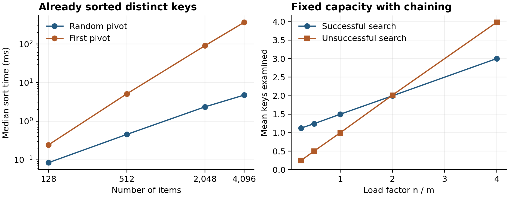

# Understanding Algorithm Efficiency and Scalability

Ravi Shanker Thadishetti
University of the Cumberlands
MSCS-532-B01 Algorithms and Data Structures
Michael Solomon
November 8, 2026


## Quicksort Design and Correctness

This project examines how pivot selection and hash-table occupancy affect scalability. The Python implementations separate these decisions from the surrounding code so their effects can be measured. Randomized Quicksort avoided the severe slowdown of a first-element pivot on ordered inputs. The chained hash table kept expected lookup work small by controlling occupancy. These results support different design decisions: randomize partitions when input order is uncertain, and resize hash storage before long chains become routine.

Both Quicksort variants sort a list in place and return None. The randomized version selects an index uniformly from the current inclusive subarray using randrange(left, right + 1). The deterministic version always selects left. Both call the same two-pass partition routine. The first pass gathers values smaller than the pivot; the second gathers equal values. This extra pass costs comparisons, but removes the entire equal group from later work. Empty and singleton ranges require no partition.

```text
partition(range, pivot) -> less | equal | greater
while an active range has at least two elements:
    select a random index or the first index
    partition using the shared two-pass procedure
    defer the larger side on an explicit stack
    continue immediately with the smaller side
```

After partitioning, every left value is smaller than the pivot, every middle value equals it, and every right value is larger. Swaps preserve the original multiset. Sorting the two strict sides therefore sorts the whole range; both are shorter, so processing terminates. The implementation assumes a consistent ordering among values and excludes NaN or incompatible mixed types. Neither variant preserves the original order of equal records.


## Quicksort Complexity

Let n be the number of distinct keys. Partitioning performs between n − 1 and 2(n − 1) key comparisons. A uniformly selected pivot has each rank with probability 1/n. Averaging over ranks gives the recurrence below, with T(0) and T(1) constant. This is an expectation over pivot choices for any fixed input, rather than an assumption that users supply randomly ordered data (Lynn, n.d.).

E[T(n)] = (2/n) ∑ₖ₌₀ⁿ⁻¹ E[T(k)] + Θ(n)

An indicator argument explains the logarithmic factor. Label sorted keys z₁ through zₙ. Keys zᵢ and zⱼ encounter one another as pivot and nonpivot exactly when one of them is the first pivot chosen from their rank interval. That event has probability 2/(j − i + 1) (Bagchi, 2025). Our two passes compare such a pair at most twice, so the actual comparison count Q satisfies:

E[Q] ≤ 4 ∑₁≤ᵢ<ⱼ≤ₙ 1/(j − i + 1) = O(n log n)

The harmonic sum supplies the upper bound; the comparison-sorting lower bound over distinct permutations supplies the matching average lower bound. Thus expected time is Θ(n log n). The familiar exact comparison formula for a one-pass Quicksort is not the count for this implementation.

T(n) = T(n − 1) + Θ(n) = Θ(n²)

Repeated extreme pivots yield the worst-case recurrence above. Randomization reduces exposure to a fixed bad order but does not remove this possibility. All-equal input instead finishes in one partition, taking Θ(n). The explicit stack processes the smaller side first; each additional nested range at least halves, giving O(log n) auxiliary space even when total work is quadratic. Partition storage itself is O(1).


## Experimental Method and Timings

The experiment ran on CPython 3.12.14, Linux x86_64. Sizes were 128, 512, 2,048, and 4,096. Each size used random distinct, ascending, descending, eight-value repeated, and all-equal inputs. Seven paired trials per configuration produced 280 timed runs. Randomized trials used recorded input and pivot seeds. One warmup preceded each configuration, and execution order alternated between the two implementations.

The perf_counter_ns timer covered sorting, including random-generator initialization. Copying inputs and checking against sorted were outside the timed interval. Garbage collection was disabled only during measurement and restored afterward. The CSV files retain every trial, medians, quartiles, and ranges. Separate instrumented runs counted calls to the same comparison operator without contaminating timing results.

**Table 1. Median Quicksort Time at 4096 Elements**

| Input | Randomized ms | First pivot ms |
| --- | --- | --- |
| Random distinct | 4.906 | 4.163 |
| Ascending | 4.746 | 365.847 |
| Descending | 5.203 | 480.618 |
| Eight values | 1.017 | 0.953 |
| All equal | 0.403 | 0.375 |

*Note.* Seven trials per cell. Both methods use identical partition and stack code.

The first-pivot method was slightly faster on the sampled random inputs, where it avoided random-number overhead and happened to produce favorable partitions. On ascending and descending inputs it was approximately 77 and 92 times slower, respectively. This distinction matters: randomization protects against structured input, but does not guarantee the fastest individual run.


## Scaling and Interpretation

**Figure 1. Pivot Sensitivity and Hash Search Work**



*Note.* Left: median times on ascending inputs, with logarithmic axes. Right: mean key examinations across 20 hash trials per load factor; the hash methodology is described on page 7.

Doubling ascending input from 2,048 to 4,096 increased first-pivot time from 90.93 to 365.85 ms, a factor of 4.02. Randomized time grew from 2.35 to 4.75 ms, a factor of 2.02. These observations are consistent with quadratic and expected n log n growth, respectively; four sizes do not constitute a proof.

The comparison counts explain the difference more directly. At 4,096 ascending keys, first-pivot Quicksort performed 16,773,120 comparisons, exactly n(n − 1) for this two-pass extreme-pivot path. The randomized run performed 80,645. Both methods needed only 8,190 comparisons on all-equal input because they removed all equal keys at once.

Wall-clock time also reflects swaps, loop overhead, allocation, and system scheduling. For example, descending input took longer than ascending input in the deterministic version despite fewer comparisons. Seven trials and separate counts improve interpretation, but the results describe these pure-Python implementations on one environment, not every Quicksort implementation or machine.


## Hash Table Design and Expected Cost

ChainedHashTable stores explicit key–value pairs in list-based buckets. Insert replaces existing values without increasing size. Search and delete raise KeyError for absent keys; None is a valid value. Deletion swaps the matched pair with the bucket’s last pair before popping, avoiding a shift. No dictionary backs storage.

Keys are integers in [0, p), with p = 2⁶¹ − 1; booleans are rejected. This universe avoids silently aliasing arbitrary-size keys modulo p. For m buckets, a is sampled uniformly from 1 through p − 1 and b from 0 through p − 1:

h(k) = ((ak + b) mod p) mod m

This universal family bounds collision probability by 1/m for distinct keys. Its expectation is over hash parameters, assuming keys independent of those parameters; reproducible seeds do not protect against adaptive adversaries (Demaine et al., 2020).

Load factor α = n/m describes occupancy. Under simple uniform hashing, search takes expected Θ(1 + α), including hashing. Insert scans for duplicates and delete locates its key, sharing that bound before resizing. A single chain containing every key causes Θ(n) worst-case work.

The table doubles before insertion would exceed α = 0.75 and halves after deletion drops α below 0.20, respecting its initial minimum. Rehashing samples fresh parameters and takes Θ(n + m). Separated thresholds allow a linear number of updates between opposite resize events, giving expected amortized O(1) updates and expected O(1) lookup. Space is O(n + m), or O(n + 1) with default resizing and a fixed initial minimum.


## Hash Measurements and Validation

The load experiment fixed capacity at 1,024 and disabled resizing to isolate occupancy. At each of five loads, 20 seeded trials inserted distinct sampled keys, searched every present key, and probed 1,024 disjoint absent keys. The 100 trials measured key examinations, not elapsed time. Default resizing was tested separately.

**Table 2. Mean Key Examinations per Hash Search**

| Load α | Successful | Unsuccessful | Largest chain |
| --- | --- | --- | --- |
| 0.25 | 1.124 | 0.250 | 4 |
| 0.50 | 1.243 | 0.503 | 6 |
| 1.00 | 1.498 | 0.998 | 6 |
| 2.00 | 1.996 | 2.014 | 9 |
| 4.00 | 3.002 | 3.984 | 15 |

*Note.* Largest chain is the maximum across 20 trials. Probe counts exclude initial hash computation.

At α = 4, absent and successful searches examined about four and three keys, matching the simple-uniform-hashing reference means α and 1 + (n − 1)/(2m). Universal hashing guarantees a collision bound rather than full independence, so this agreement does not prove the stronger model. Higher occupancy trades bucket memory for more search work.

All 11 tests passed. Sorting checks include 3,280 ternary arrays through length seven, all 5,040 seven-key permutations, partition invariants, negative values, and long ordered/equal inputs. Hash tests cover forced collisions, replacement, None, missing and boundary keys, growth, shrinkage, and invalid-input atomicity. Ten seeded sequences totaling 10,000 operations were checked against a dictionary.

Future work should measure rehashing latency and memory, explore skewed or adversarial keys, and compare pivot heuristics. Larger samples would help separate interpreter costs from algorithmic growth.


## References

Bagchi, A. (2025, July 27). *Running time analysis for randomized quicksort*. Indian Institute of Technology Delhi. https://www.cse.iitd.ac.in/~bagchi/courses/COL863_25-26/randomized-quicksort-analysis-july-2025v2.pdf

Demaine, E., Ku, J., & Solomon, J. (2020). *Lecture 4 Hashing*. MIT OpenCourseWare. https://ocw.mit.edu/courses/6-006-introduction-to-algorithms-spring-2020/ce9e94705b914598ce78a00a70a1f734_MIT6_006S20_lec4.pdf

Lynn, B. (n.d.). *Quicksort*. Stanford University. https://crypto.stanford.edu/~blynn/pr/qsort.html
